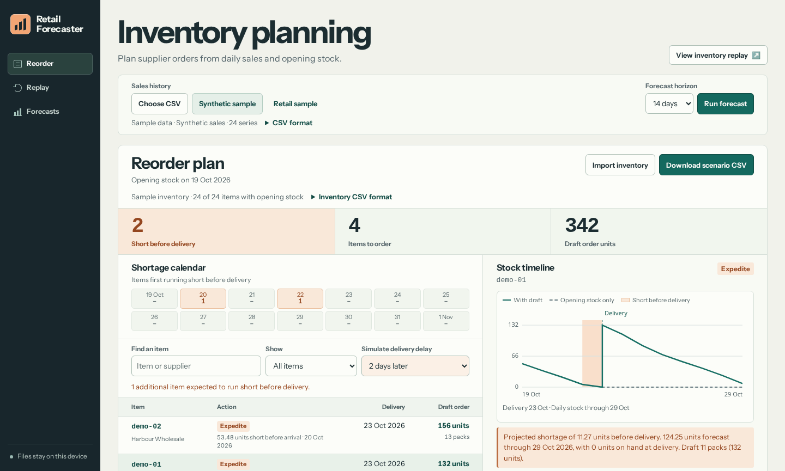
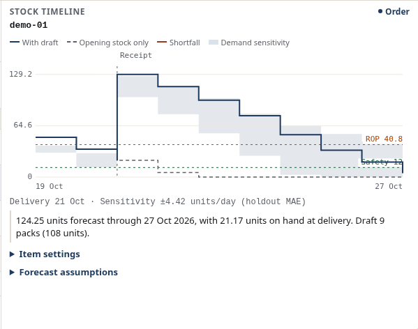
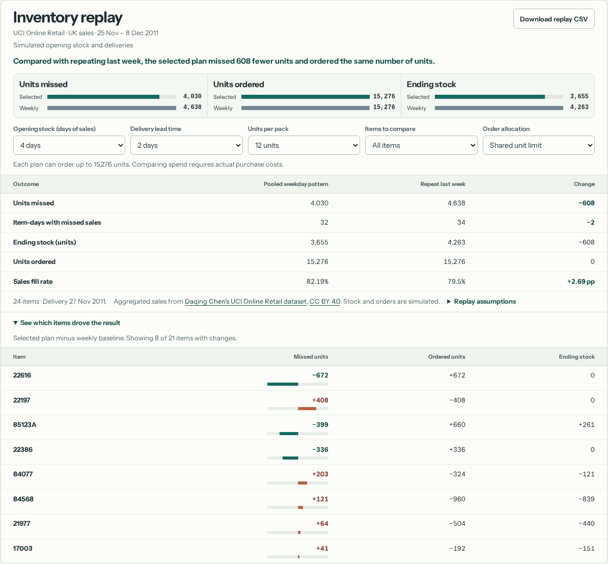

# Retail Forecaster

Plan supplier orders from sales and stock CSVs. See which items run short before delivery, draft orders in whole packs, and replay the decisions on held-out sales.



## Try it

1. Open [Retail_Forecaster_Demo.html](Retail_Forecaster_Demo.html) on GitHub and select **Download raw file**.
2. Open the downloaded HTML in your browser. The workspace starts with sample sales and inventory and runs offline.
3. Select **2 days later** under **Simulate delivery delay**. Click an orange date in the shortage calendar to see the items that first run short that day.

To run from a clone with Python 3.10 or later, enter this command and open the local address it prints.

```sh
python3 serve.py
```

## The reorder workflow

| View | What it answers |
| --- | --- |
| **Shortage calendar** | Which items first run short before their delivery, and on which day? |
| **Stock timeline** | How much stock is projected each day, with and without the draft order? |
| **Order draft** | What pack quantities can I order, and which items need a faster delivery? |
| **Inventory replay** | How did the forecasts compare on missed sales, orders, and ending stock? |
| **Forecast evidence** | How did the selected model perform against the weekly baseline on held-out dates? |

In the synthetic example, a two-day delay moves delivery for demo-01 from **21 to 23 October**. The draft rises from **108 to 132 units**, and the item shows an estimated **11.27 units short before delivery**.



## Compare decisions on recorded sales

Choose **Retail sample**, then **View inventory replay**. With a shared order quantity, each forecast allocates the same total number of units. The product-level bars show where those allocations led to more or fewer missed units.



| Held-out window | Ordered units per plan | Selected missed units | Weekly baseline missed units |
| --- | ---: | ---: | ---: |
| 25 Nov–8 Dec 2011 | 15,276 | 4,030 | 4,638 |
| 11 Nov–8 Dec 2011 | 38,400 | 10,696 | 10,162 |

The sample uses recorded UCI Online Retail sales. Opening stock and deliveries are simulated. A shared unit limit controls quantity, and comparing spend requires purchase costs. [Data and evaluation method](docs/methodology.md)

## Bring your own data

Import a sales CSV with daily **series_id**, **date**, and **units** columns. Import an inventory CSV or open **Item settings** to enter stock, lead time, coverage, and pack size. Download order, forecast, and replay CSVs from their respective views. [CSV formats, examples, and model details](docs/methodology.md)

## Build and verify

The offline demo embeds its charts, sample data, and typeface. The local server uses the Python standard library.

```sh
python3 make_preview.py Retail_Forecaster_Demo.html
python3 -m unittest test_browser_parity
node --test test_reorder.js test_replay.js
```

The UCI sample is adapted under CC BY 4.0. Instrument Sans is distributed under the SIL Open Font License. [Dataset credit](docs/methodology.md#data-and-licensing) · [Font license](web/fonts/OFL-Instrument-Sans.txt)
