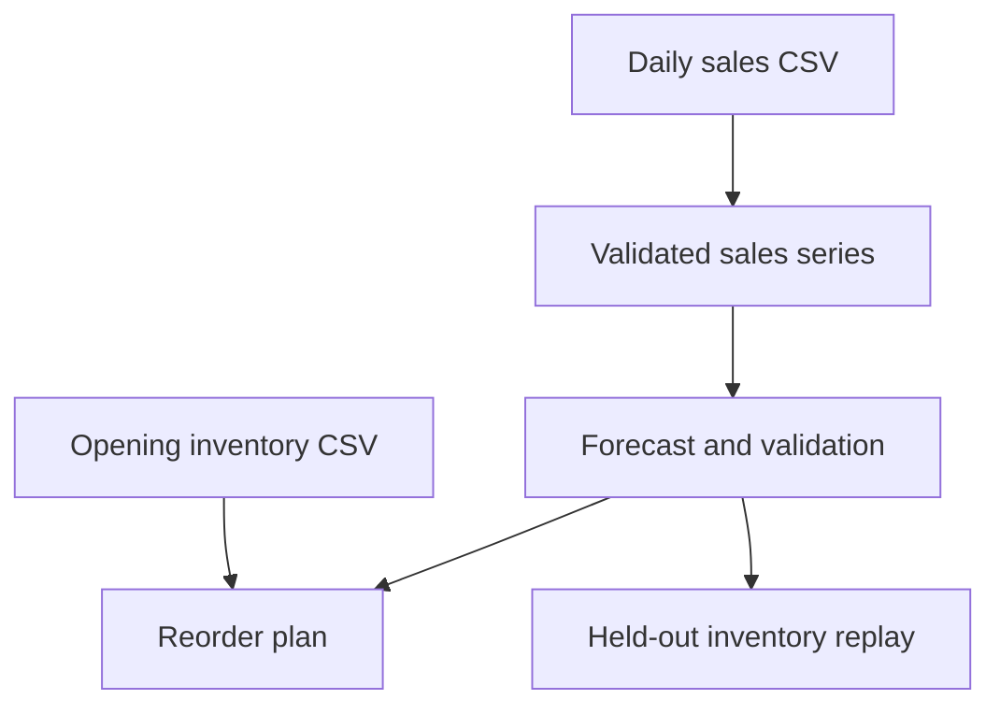

# Retail Forecaster guide



## Sales and inventory inputs

Both inputs accept UTF-8 CSVs up to 10 MiB each. The standalone dashboard processes sales in the browser. The optional local Python server processes sales in memory on the same device. The app keeps uploaded data for the current session.

### Sales history

```csv
series_id,date,units
store-a:item-123,2026-11-01,6
store-a:item-123,2026-11-02,0
```

Give each product or product-store pair a series ID. Use ISO dates and one row per day per series with finite, nonnegative sales. Enter zero for observed days without sales. A series can begin on a different date, and all series must end on the same date. Gaps and duplicates produce an error.

### Opening inventory

```csv
series_id,on_hand,lead_days,cover_days,pack_size,supplier,stock_date
store-a:item-123,50,2,7,12,Example Supplier,2026-11-03
```

Match each series ID with sales history. Enter the inventory at the start of the first forecast date. A blank on-hand amount is treated as missing. Optional lead time defaults to zero days, coverage to seven days, and pack size to one unit. Include a supplier name to make it searchable. When a stock date is supplied, it must match the first forecast date.

The calendar counts items on their first projected shortage date **before delivery**. Clicking that date filters the reorder queue. The stock timeline shows the opening balance consumed by forecast demand, with a proposed receipt added before sales on its delivery date. Use the arrow keys on the chart to inspect the date, sales forecast, and stock balances.

Lead time counts full days before delivery. For a Monday start and a lead time of two days, the receipt is available before Wednesday sales. The draft covers the chosen number of days from delivery and rounds the residual demand up to whole packs. Forecast sales missed before delivery contribute to pre-delivery risk. The draft uses the stock that remains at delivery to calculate post-delivery requirements. If the horizon does not cover the complete cycle, the planner shows any identifiable shortage and requests a longer forecast for the draft.

The order export includes positive draft quantities for the scenario, with delivery dates and lead times. The forecast export retains fractional expected sales. CSV exports protect spreadsheet-formula-like names and IDs by prefixing them with an apostrophe.

## Forecasting and evaluation

| Method | Estimate |
| --- | --- |
| **Repeat last week** | Repeats the last seven observed days and averages shorter histories. |
| **Recent average** | Uses average sales from the last 28 observed days. |
| **Item weekday average** | Estimates each item's weekdays over the last eight weeks, with sparse weekdays pulled toward that item's mean. |
| **Pooled weekday pattern** | Learns a weekday pattern across items and scales it to each item's recent sales. |

Three historical selection windows are followed by a reserved holdout. Each window lasts as long as the forecast horizon. The selection chooses the method with the lowest total absolute error and reports holdout results against the weekly baseline. Forecasts use the available observations up to the relevant cutoff.

At least one series must have 28 training days plus four forecast windows for the dashboard to compare models. The thresholds are 56, 84, and 140 days of history for the 7-, 14-, and 28-day horizons. With shorter histories the dashboard uses a recent sales baseline. WAPE and unit bias are undefined when observed sales sum to zero. Sparse series have positive sales on fewer than half of the last 56 training days.

### Inventory replay

Replays estimate opening stock from the preceding 28-day average and the chosen opening days. The same start stock, lead time, pack size, and observed sales apply to both methods. Each plan gets one receipt before sales on its delivery date. Any observed demand exceeding available stock counts as a simulated missed sale. The model never sees held-out sales when drafting the orders.

The shared unit limit uses the smaller unrestricted order. Each forecast allocates the available packs according to the demand a pack could cover, favoring earlier forecast shortages when the coverage is equal. Unrestricted orders use each forecast's unconstrained quantities. The product breakdown uses selected minus baseline, ordered by absolute difference in missed units. The export includes all eligible products and the run settings.

### Recorded retail results

Each row uses 24 UCI products, four days of opening stock, a two-day lead time, and 12-unit packs. The two 14-day windows are disjoint. The shorter and longer windows ending on 8 December overlap the later 14-day window.

| Held-out dates, 2011 | Units ordered per plan | Selected missed units | Weekly missed units | Selected ending stock | Weekly ending stock |
| --- | ---: | ---: | ---: | ---: | ---: |
| 11–24 November | 16,068 | 5,125 | 5,697 | 5,003 | 5,575 |
| 2–8 December | 3,144 | 4,550 | 5,118 | 912 | 1,480 |
| 25 November–8 December | 15,276 | 4,030 | 4,638 | 3,655 | 4,263 |
| 11 November–8 December | 38,400 | 10,696 | 10,162 | 10,282 | 9,748 |

With unrestricted orders in the later 14-day window, the selected forecast missed 1,606 fewer units and ordered 2,244 more. The shared unit limit reduces the difference in missed units to 608. The dataset contains recorded sales. Further evaluation requires more retailers and actual inventory, receipt, purchase cost, and unmet-demand histories.

### Command-line checks

```sh
python3 make_demo.py history.csv
python3 forecast.py evaluate history.csv --horizon 14 --report evaluation.json
python3 forecast.py predict history.csv --horizon 14 --model pooled-weekday --output forecast.csv
```

The synthetic sample has 24 items. With its bundled seed, the pooled weekday model has **18.12% WAPE** on the 14-day holdout compared with **25.36%** for its weekly baseline. The results include substantial errors for sparse items. [Synthetic evaluation report](../demo-evaluation.json)

## Data and licensing

The bundled sales data adapts *Online Retail* by Daqing Chen (2015), UCI Machine Learning Repository, licensed under CC BY 4.0. The preparation script groups positive UK invoice quantities into daily product totals, excludes cancellations and the final partial date, and fills days without recorded sales with zeros. Product ranking uses dates through 10 November 2011 and includes 12 regular and 12 sparse series. Only daily product totals are distributed. [Dataset DOI](https://doi.org/10.24432/C5BW33) · [CC BY 4.0](https://creativecommons.org/licenses/by/4.0/)

Download the UCI ZIP archive and use the preparation script with openpyxl installed. [UCI ZIP archive](https://archive.ics.uci.edu/static/public/352/online+retail.zip)

```sh
python3 prepare_retail_sample.py online+retail.zip sample-data/uci-retail.csv
```
